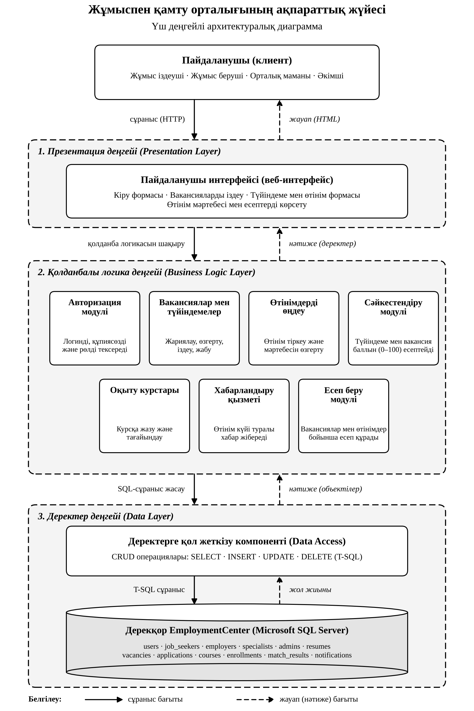

# Архитектуралық диаграмма

**Тақырып:** Жұмыспен қамту орталығының ақпараттық жүйесі

Жүйе үш деңгейлі архитектура бойынша жобаланды: презентация деңгейі, қолданбалы логика деңгейі және деректер деңгейі.

## Ақпарат ағыны

Пайдаланушы → Пайдаланушы интерфейсі → Қолданбалы логика → Деректерге қол жеткізу → Дерекқор.

Жауап деректерді өңдеу нәтижесіне сәйкес кері бағытта беріледі. Диаграммада сұраныс бағыты тұтас сызықпен, жауап бағыты үзік сызықпен көрсетілген.

## Компоненттер

| Деңгей | Компонент | Міндеті |
|---|---|---|
| Клиент | Пайдаланушы | Жүйемен жұмыс істейді: жұмыс іздеуші, жұмыс беруші, орталық маманы, әкімші |
| 1. Презентация | Пайдаланушы интерфейсі | Кіру формасы, вакансияларды іздеу, түйіндеме мен өтінім формасы, өтінім мәртебесі мен есептерді көрсету |
| 2. Қолданбалы логика | Авторизация модулі | Логин, құпиясөз және рөлді (`job_seeker`, `employer`, `specialist`, `admin`) тексереді |
| 2. Қолданбалы логика | Вакансиялар мен түйіндемелер | Вакансия мен түйіндемені жариялау, өзгерту, іздеу, жабу |
| 2. Қолданбалы логика | Өтінімдерді өңдеу | Өтінімді тіркеу және мәртебесін өзгерту (`submitted`, `reviewed`, `accepted`, `rejected`) |
| 2. Қолданбалы логика | Сәйкестендіру модулі | Түйіндеме мен вакансияның сәйкестік баллын (0–100) есептейді |
| 2. Қолданбалы логика | Оқыту курстары | Жұмыс іздеушіні курсқа жазу және курсты тағайындау |
| 2. Қолданбалы логика | Хабарландыру қызметі | Өтінім күйі туралы хабарлама жібереді |
| 2. Қолданбалы логика | Есеп беру модулі | Вакансиялар мен өтінімдер бойынша есеп құрады |
| 3. Деректер | Деректерге қол жеткізу компоненті | CRUD операциялары: `SELECT`, `INSERT`, `UPDATE`, `DELETE` (T-SQL) |
| 3. Деректер | Дерекқор `EmploymentCenter` | Деректерді сақтайды (Microsoft SQL Server, 12 кесте) |

## Дерекқор кестелері

`users`, `job_seekers`, `employers`, `specialists`, `admins`, `resumes`, `vacancies`, `applications`, `courses`, `enrollments`, `match_results`, `notifications`.

Дерекқордың құрылымы [`database/01_create_tables.sql`](../database/01_create_tables.sql) файлында сипатталған.

## Қолданбалы логика модульдерінің кестелермен байланысы

| Модуль | Қолданатын кестелер |
|---|---|
| Авторизация модулі | `users`, `admins` |
| Вакансиялар мен түйіндемелер | `vacancies`, `employers`, `resumes`, `job_seekers` |
| Өтінімдерді өңдеу | `applications` |
| Сәйкестендіру модулі | `match_results`, `resumes`, `vacancies` |
| Оқыту курстары | `courses`, `enrollments`, `specialists` |
| Хабарландыру қызметі | `notifications` |
| Есеп беру модулі | `vacancies`, `applications`, `users` |

## Үш деңгейлі архитектураны таңдау себебі

- Интерфейс, бизнес-ережелер және деректер бір-бірінен бөлінген, сондықтан бір деңгейді өзгерткенде басқалары бұзылмайды.
- Рөлдерді тексеру мен өтінім мәртебесін өзгерту ережелері бір жерде (қолданбалы логикада) жиналған.
- Дерекқорға тек деректерге қол жеткізу компоненті қосылады, сондықтан SQL-сұраныстар бір орында басқарылады.
