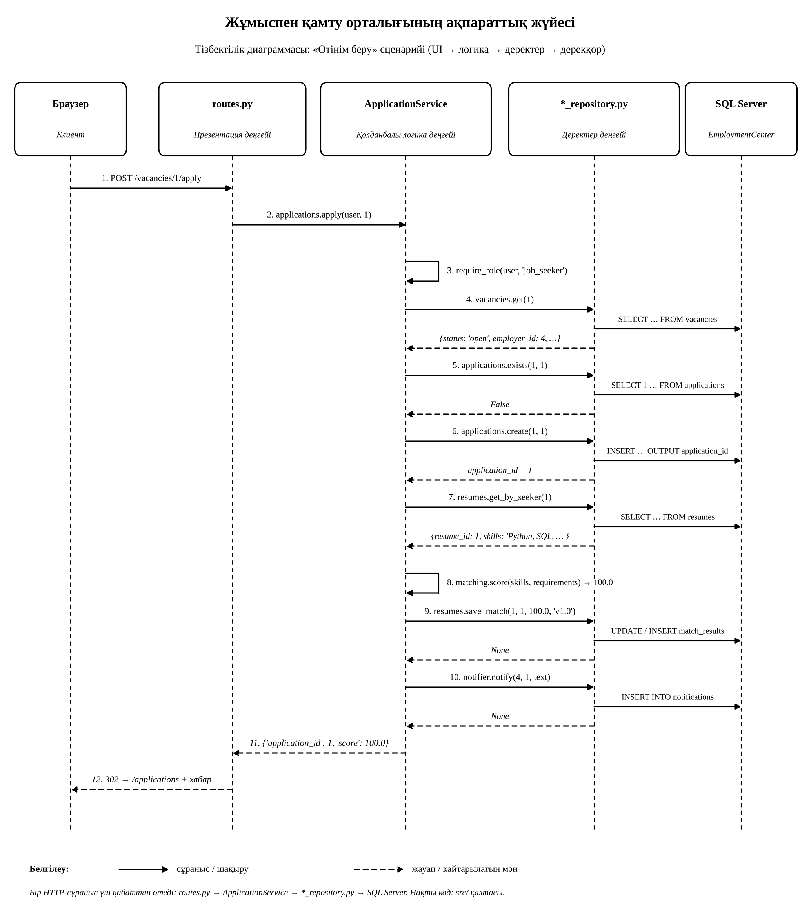

# Архитектуралық диаграмма

**Тақырып:** Жұмыспен қамту орталығының ақпараттық жүйесі

Жүйе үш деңгейлі архитектура бойынша жобаланды және **жұмыс істейтін кодпен** расталған (`src/` қалтасы). Диаграммадағы әр компонент кодтағы нақты файл мен класқа сәйкес келеді.


## 1. Код құрылымы мен деңгейлер

```
src/
  app.py                        # үш деңгейді жалғайды (composition root)
  config.py                     # SQL Server-ге қосылу параметрлері
  presentation/                 # 1. Презентация деңгейі
    routes.py                   #    HTTP маршруттар (Flask)
    templates/*.html            #    HTML беттер (Jinja2)
  business/                     # 2. Қолданбалы логика деңгейі
    auth_service.py             #    Авторизация модулі
    vacancy_service.py          #    Вакансиялар
    application_service.py      #    Өтінімдерді өңдеу
    matching_service.py         #    Сәйкестендіру модулі
    course_service.py           #    Оқыту курстары
    notification_service.py     #    Хабарландыру қызметі
    report_service.py           #    Есеп беру модулі
  data/                         # 3. Деректер деңгейі
    database.py                 #    pyodbc арқылы SQL Server-мен байланыс
    *_repository.py             #    Деректерге қол жеткізу компоненті (SQL осында)
tests/                          # тесттер
database/                       # SQL скрипттері (дерекқор)
```

| Деңгей | Компонент | Файл | Міндеті |
|---|---|---|---|
| Клиент | Пайдаланушы | браузер | Формаларды толтырады, беттерді көреді |
| 1. Презентация | Пайдаланушы интерфейсі | `presentation/routes.py`, `templates/*.html` | HTTP сұранысты қабылдайды, қызметті шақырады, нәтижені HTML-мен көрсетеді |
| 2. Логика | Авторизация модулі | `business/auth_service.py` | Email мен құпиясөзді (SHA-256 хэш) тексереді |
| 2. Логика | Вакансиялар | `business/vacancy_service.py` | Іздеу, жариялау, жабу; рөл мен иелікті тексереді |
| 2. Логика | Өтінімдерді өңдеу | `business/application_service.py` | Өтінім беру, мәртебені өзгерту, тізім |
| 2. Логика | Сәйкестендіру модулі | `business/matching_service.py` | Түйіндеме мен вакансия баллын (0–100) есептейді |
| 2. Логика | Оқыту курстары | `business/course_service.py` | Курстар тізімі, курсқа жазылу |
| 2. Логика | Хабарландыру қызметі | `business/notification_service.py` | Өтінім оқиғалары туралы хабарлама |
| 2. Логика | Есеп беру модулі | `business/report_service.py` | Вакансиялар мен өтінімдер бойынша жиынтық |
| 3. Деректер | Деректерге қол жеткізу | `data/*_repository.py`, `data/database.py` | Барлық SQL-сұраныстар (параметрлі) |
| 3. Деректер | Дерекқор | SQL Server, `EmploymentCenter` | 12 кесте (`database/01_create_tables.sql`) |

## 2. Деңгейлер арасындағы шақырулар

Бір HTTP-сұраныс үш деңгейден қалай өтетінін мына тізбектілік диаграммасы көрсетеді («Өтінім беру» сценарийі):



### 2.1. Клиент → Презентация деңгейі

Пайдаланушы вакансияда «Өтінім беру» батырмасын басады, браузер `POST /vacancies/1/apply` жібереді. Flask сұранысты `routes.py` ішіндегі функцияға бағыттайды:

```python
    @bp.route("/vacancies/<int:vacancy_id>/apply", methods=["POST"])
    @login_required
    def apply(vacancy_id):
        result = services["applications"].apply(current_user(), vacancy_id)
        score = result["score"]
        flash("Өтінім қабылданды" + (f". Сәйкестік: {score}%" if score is not None else ""))
        return redirect(url_for("web.applications"))

```

`login_required` декораторы кірмеген пайдаланушыны `/login` бетіне жібереді, ал логика деңгейінен шыққан қатені (`BusinessError`) хабарлама ретінде көрсетеді:

```python
    def login_required(view):
        """Кірмеген пайдаланушыны /login-ге жібереді; бизнес-қатені хабар етіп көрсетеді."""
        @wraps(view)
        def wrapper(*args, **kwargs):
            if not current_user():
                return redirect(url_for("web.login"))
            try:
                return view(*args, **kwargs)
            except BusinessError as error:
                flash(str(error))
                return redirect(request.referrer or url_for("web.vacancies"))
        return wrapper

```

Презентация деңгейі тек `services[...]` арқылы логика деңгейін шақырады. Ол SQL-ді де, бизнес-ережені де білмейді.

### 2.2. Презентация → Қолданбалы логика

`ApplicationService.apply()` өтінім берудің барлық ережесін орындайды:

```python
    def apply(self, user: dict, vacancy_id: int) -> dict:
        # 1. Рөлді тексеру
        require_role(user, "job_seeker")
        # 2. Вакансия бар және ашық па?
        vacancy = self.vacancies.get(vacancy_id)
        if vacancy is None:
            raise BusinessError("Вакансия табылмады")
        if vacancy["status"] != "open":
            raise BusinessError("Вакансия жабық")
        # 3. Қайталанбайтынын тексеру
        if self.applications.exists(user["user_id"], vacancy_id):
            raise BusinessError("Сіз бұл вакансияға өтінім беріп қойғансыз")
        # 4. Өтінімді сақтау
        application_id = self.applications.create(user["user_id"], vacancy_id)
        # 5. Сәйкестік баллын есептеп, сақтау
        score = None
        resume = self.resumes.get_by_seeker(user["user_id"])
        if resume:
            score = self.matching.score(resume["skills"], vacancy["requirements"])
            self.resumes.save_match(
                resume["resume_id"], vacancy_id, score, self.matching.MODEL_VERSION
            )
        # 6. Жұмыс берушіге хабарлама жіберу
        self.notifier.notify(
            vacancy["employer_id"],
            application_id,
            f"{vacancy['title']} вакансиясына жаңа өтінім түсті",
        )
        return {"application_id": application_id, "score": score}

```

### 2.3. Қолданбалы логика → Деректерге қол жеткізу

Қызмет SQL білмейді, тек репозиторий әдістерін шақырады (`vacancies.get`, `applications.exists`, `applications.create`, `resumes.save_match`, `notifier.notify`). Мысалы, өтінімді сақтау:

```python
    def create(self, seeker_id: int, vacancy_id: int) -> int:
        return self.db.execute(
            "INSERT INTO applications (seeker_id, vacancy_id) "
            "OUTPUT INSERTED.application_id VALUES (?, ?)",
            (seeker_id, vacancy_id),
            returns_id=True,
        )
```

### 2.4. Деректерге қол жеткізу → Дерекқор

Репозиторий SQL-ді `Database` класы арқылы SQL Server-ге жібереді. SQL параметрлері (`?`) бөлек беріледі, сондықтан SQL injection болмайды:

```python
    def execute(self, sql: str, params: tuple = (), returns_id: bool = False):
        """INSERT/UPDATE/DELETE. returns_id=True болса, OUTPUT INSERTED.* мәнін қайтарады."""
        with closing(self._connect()) as conn:
            cur = conn.cursor()
            cur.execute(sql, params)
            new_id = cur.fetchone()[0] if returns_id else None
            conn.commit()
            return new_id
```

Жауап кері бағытта қайтады: дерекқор → `application_id` → `ApplicationService` → `{'application_id': 1, 'score': 100.0}` → `routes.py` → браузерге `302 → /applications` және хабарлама.

### 2.5. Сәйкестендіру модулі (қызмет ішіндегі есептеу)

```python
    def score(self, skills, requirements) -> float:
        """Талаптардың қаншасы дағдыларда бар екенін пайызбен (0–100) қайтарады."""
        need = self._phrases(requirements)
        if not need:
            return 0.0
        have = self._phrases(skills)
        return round(100.0 * len(need & have) / len(need), 2)
```

## 3. Басқа сценарийлер

| Әрекет | Маршрут (презентация) | Қызмет (логика) | Репозиторий (деректер) |
|---|---|---|---|
| Кіру | `POST /login` | `AuthService.login()` | `UserRepository.get_by_email()` |
| Вакансияларды іздеу | `GET /vacancies?q=...` | `VacancyService.search()` | `VacancyRepository.list_with_counts()` |
| Вакансия жариялау | `POST /vacancies` | `VacancyService.publish()` | `VacancyRepository.create()` |
| Өтінім беру | `POST /vacancies/<id>/apply` | `ApplicationService.apply()` | `VacancyRepository.get()`, `ApplicationRepository.exists()/create()`, `ResumeRepository.save_match()`, `NotificationRepository.create()` |
| Мәртебені өзгерту | `POST /applications/<id>/status` | `ApplicationService.change_status()` | `ApplicationRepository.update_status()`, `NotificationRepository.create()` |
| Курсқа жазылу | `POST /courses/<id>/enroll` | `CourseService.enroll()` | `CourseRepository.is_enrolled()/enroll()` |
| Есеп | `GET /reports` | `ReportService.vacancy_report()` | `VacancyRepository.list_with_counts()` |

Рөлдер: `job_seeker` өтінім береді және курсқа жазылады; `employer` вакансия жариялап, өз вакансиясының өтінімдерін өңдейді; `specialist` пен `admin` барлық өтінімді көріп, есеп алады.

## 4. Деңгейлер шекарасын тексеру

Тәуелділік тек жоғарыдан төмен бағытталған: `presentation → business → data`.

| Деңгей | Импорттай алмайды |
|---|---|
| `presentation` | `data`, `pyodbc` |
| `business` | `flask`, `pyodbc`, `data`, `presentation` |
| `data` | `flask`, `business`, `presentation` |

Бұл ережені `tests/test_architecture.py` автоматты түрде тексереді. Ал `tests/test_flow.py` UI-дан логика деңгейіне дейінгі ағынды (өтінім беру, қайталанатын өтінім, жабық вакансия, мәртебені өзгерту, рөлді тексеру) HTTP-сұраныстар арқылы тексереді.

## 5. Іске қосу

1. Алдымен дерекқорды құрыңыз: `database/01_create_tables.sql`, `02_insert_data.sql`, `03_demo_passwords.sql` файлдарын SSMS-те ретімен орындаңыз (не `sync-db.ps1` скриптін қолданыңыз).
2. Python 3.10+ орнатып, репозиторий қалтасында:
```powershell
pip install -r requirements.txt
python -m unittest discover -s tests
python src/app.py
```
3. Браузерде `http://127.0.0.1:5000` ашыңыз. Демо пайдаланушылар (құпиясөз `123456`):

| Рөл | Email |
|---|---|
| Жұмыс іздеуші | `aigerim@mail.kz` |
| Жұмыс беруші | `bakyt@techno.kz` |
| Орталық маманы | `erlan@enbek.kz` |
| Әкімші | `aidos@enbek.kz` |

Сервер аты `src/config.py` ішінде (`BORIBEK-QAISAR\BORIBEK`), қажет болса `DB_SERVER` орта айнымалысымен өзгертіледі.
